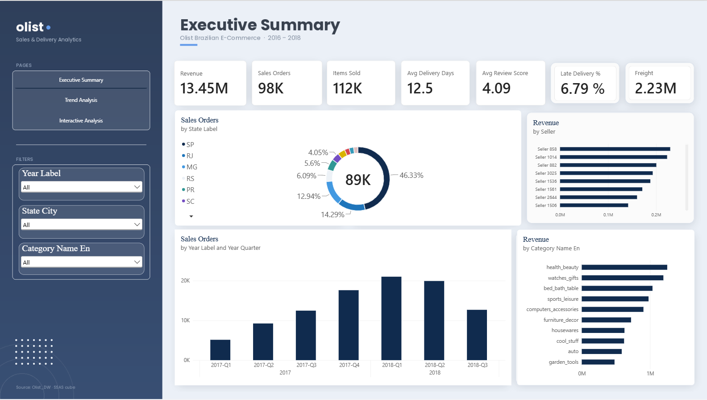
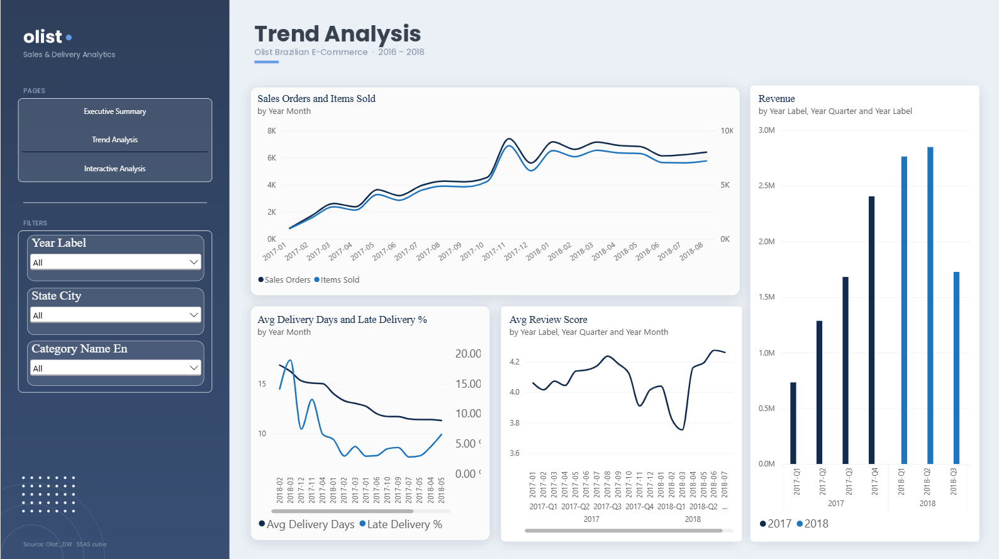
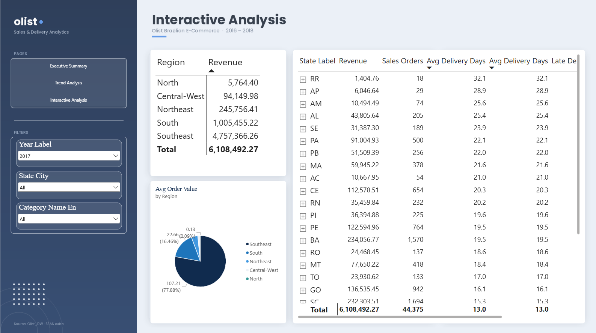

# 🛒 Olist E-Commerce Data Warehouse & BI Solution

End-to-end data warehouse and business intelligence solution built on the Microsoft BI stack for the **Olist Brazilian E-Commerce** dataset

---

## 🏗️ Architecture

```text
[Sources: SQL Server DB | CSV Files | Holiday Web API]
                       │
                       ▼
           [SSIS ETL (4 Packages)]
                       │
                       ▼
  [SQL Server: Olist_DW (Staging | Warehouse | Data Marts | ETL Log)]
                       │
                       ▼
           [SSAS Multidimensional Cube]
                       │
                       ▼
             [Power BI Dashboard]
```

## 🛠️ Tech Stack

* **Database & Warehousing:** SQL Server 2025, T-SQL
* **ETL & Scripting:** SQL Server Integration Services (SSIS), C# (SSIS Script Task)
* **OLAP:** SQL Server Analysis Services (SSAS - Multidimensional)
* **Visualization:** Power BI

## 📊 Key Highlights

* **Data Volume:** ~100,000 orders (Sept 2016 – Oct 2018) across 9 source files and 3 distinct source types.
* **Schema Design:** Fact Constellation (Galaxy) schema featuring `Fact_Sales` (112,650 rows), `Fact_OrderFulfilment` (99,441 rows), and 7 conformed dimensions.
* **Data Quality & ETL:** Full-load ETL pipeline backed by 16 automated validation checks, passing consistently across repeated runs.
* **Analytics Layer:** 2 targeted data marts, 1 multidimensional OLAP cube, and a 3-page interactive Power BI dashboard.

## 📁 Repository Structure

```text
Olist-DWBI-Solution/
├── 📂 sql/                  # DDL, staging, data marts, and validation scripts
├── 📂 ssis/                 # SSIS ETL project and packages
├── 📂 ssas/                 # SSAS multidimensional cube project
├── 📂 powerbi/              # Power BI dashboard (.pbix) files
├── 📂 docs/                 # Screenshots and project documentation
└── 📄 README.md             # Project overview and setup instructions
```

## 🚀 How to Run

1. **Download the Dataset:**
   * Fetch the *Brazilian E-Commerce Public Dataset by Olist* from Kaggle.
   * Extract and place all 9 CSV files into `C:\DWBI_Project\Source_CSV`.
2. **Initialize Source Database:**
   * Create the `Olist_OLTP_DB` database and import the raw CSVs using the initialization scripts in `sql/`.
3. **Build the Data Warehouse:**
   * Execute `03_create_warehouse.sql`, `04_create_staging.sql`, and `05_validation.sql` in SQL Server Management Studio (SSMS).
4. **Run the ETL Pipeline:**
   * Open `ssis/Olist_ETL` in Visual Studio and execute the `00_Master` package.
5. **Create Data Marts:**
   * Run `06_data_marts.sql` to populate the analytical views/marts.
6. **Deploy Cube & View Reports:**
   * Deploy the `ssas/Olist_Cube` project to your SSAS instance, then open the Power BI report to refresh and explore the visuals.

## 📈 Dashboard & Key Insights

The 3-page Power BI report connects directly to the SSAS multidimensional cube and tracks sales performance, delivery efficiency, and regional trends:

### 1️⃣ Executive Summary


* 💰 **Total Sales:** Generated **$13.45M** in revenue across **98K** orders (**112K** items sold), plus **$2.23M** in freight charges.
* ⭐ **Customer Experience:** Achieved an average review score of **4.09 / 5.0**, with an average delivery time of **12.5 days** and a **6.79%** late delivery rate.
* 📍 **Top States:** São Paulo (`SP`) leads with **46.33%** of all orders, followed by Rio de Janeiro (`RJ`, **14.29%**) and Minas Gerais (`MG`, **12.94%**).
* 🏆 **Best-Selling Categories:** `health_beauty`, `watches_gifts`, and `bed_bath_table` are the highest revenue-generating categories.

---

### 2️⃣ Trend Analysis


* 🚀 **2017–2018 Growth:** Monthly orders surged throughout 2017—peaking during the **Nov 2017** Black Friday spike (7.5K orders)—and stayed strong in **Q1–Q2 2018** ($2.8M+ revenue per quarter).
* 🚚 **Faster Deliveries Over Time:** Average delivery time dropped steadily from ~16 days in early 2017 down to ~11 days by mid-2018.
* 📉 **Late Deliveries Hurt Ratings:** Whenever late delivery rates spiked (such as **Feb–Mar 2018**), average customer review scores dipped sharply below **3.8**.

---

### 3️⃣ Interactive Analysis


* 🗺️ **Regional Revenue (2017 Filter):** Out of **$6.11M** in 2017 revenue (**44,375** orders), the **Southeast** accounted for **$4.76M** (~78%), followed by the **South** (**$1.01M**).
* ⏱️ **Logistics Gap in Remote States:** Northern states faced much longer shipping times—such as Roraima (`RR`, **32.1 days**) and Amapá (`AP`, **28.9 days**)—compared to the **13.0-day** national average.

## ⚠️ Limitations

* **Financial Metrics:** The dataset lacks product cost data, limiting analysis to gross revenue and freight rather than net profit margins.
* **Privacy Anonymization:** Customer and seller identifiers are hashed/anonymized, preventing real-world entity enrichment.
* **Timeframe:** Covers approximately two years of historical operations (2016–2018).

## 🔗 Data Sources

* **E-Commerce Data:** [Olist Brazilian E-Commerce Public Dataset](https://www.kaggle.com/datasets/olistbr/brazilian-ecommerce) on Kaggle (CC BY-NC-SA 4.0).
* **Holiday Data:** Brazilian public holidays retrieved via the [Nager.Date Public API](https://date.nager.at/).

## 📝 Notes

* Developed as a university group project.
* AI tools were utilized for architectural guidance, the project team designed, implemented, executed, and verified the entire end-to-end solution.
